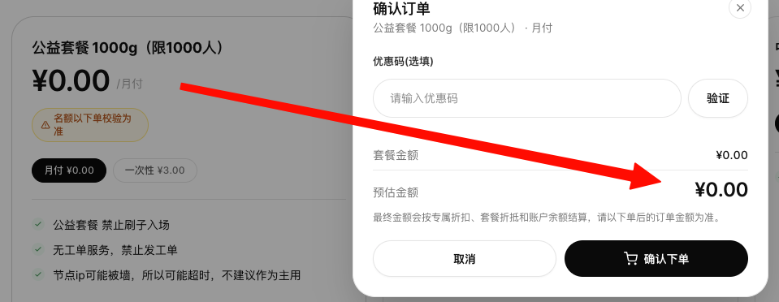
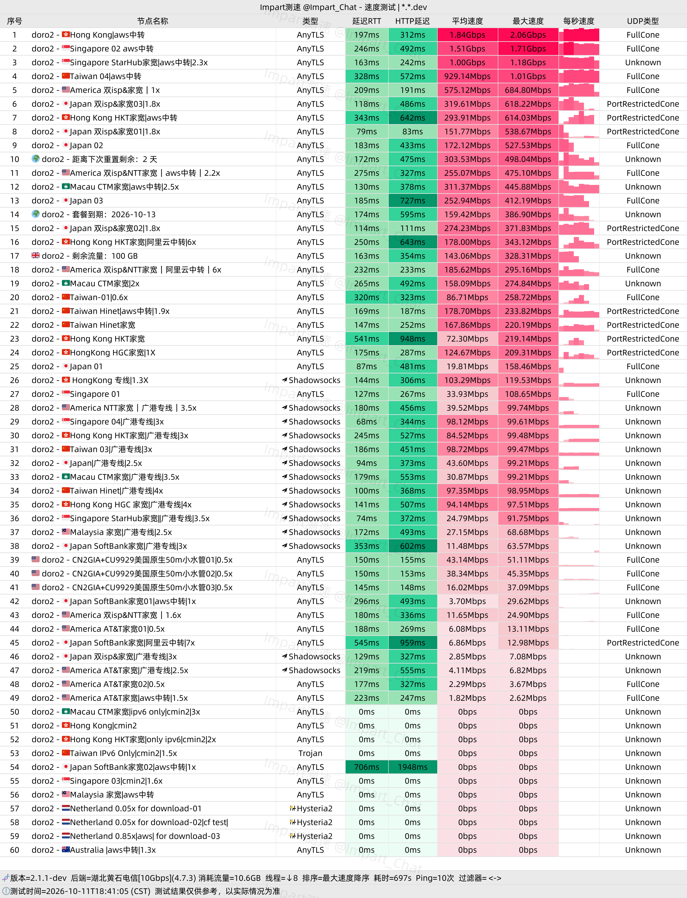
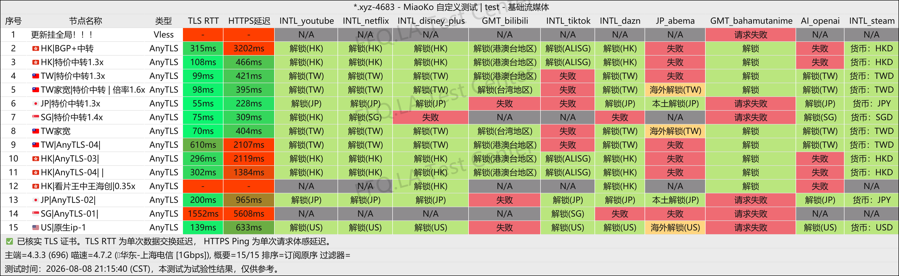
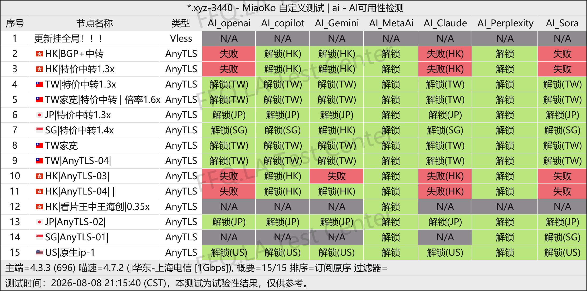
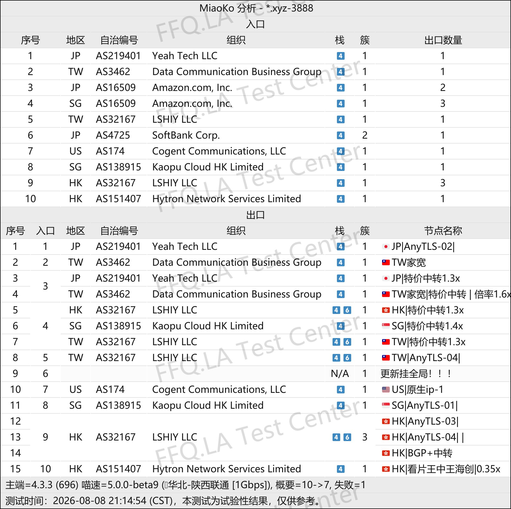

🇨🇳 [中文](README.md) | 🇺🇸 English | 🇷🇺 [Русский](README_RU.md) | 🇮🇷 [فارسی](README_FA.md)

# DoroCloud VPN Official Website (Updated November 11, 2026)

DoroCloud VPN Official Website<br>
Latest Address: [dorocloud.cn](https://to.iix.im/doro01)<br>
Official Address: [dorocloud.xyz](https://to.iix.im/doro02)<br>

Latest Recommended VPN Services and Node Sharing for 2026: [https://github.com/jdnei/JiChangTuiJian](https://github.com/jdnei/JiChangTuiJian)<br>

## Telegram VPN Deals & Benefits Community #AD

[VPN Giveaway Group](https://331024.de/archives/choujiang) | [VPN Chat Group](https://331024.de/archives/choujiang) | [VPN Trial Group](https://331024.de/archives/choujiang)<br>

[https://331024.de/archives/choujiang](https://331024.de/archives/choujiang)

## Invitation Code

`Register with this invitation code to unlock a ¥0 plan (limited to 1,000 users). The provider may cancel this promotion at any time.`

```bash
LLlUeLMa
```

<br>

## Promo Code / Discount Code

```bash
None
```

## Overview

DoroCloud VPN is a network acceleration provider launched in 2026. It offers direct connections, public internet relays, cloud-provider forwarding routes, and selected dedicated-line servers to accommodate different network environments and usage scenarios.

Its servers support protocols such as AnyTLS and utilize network resources from providers including Tencent Cloud and AWS.

DoroCloud is suitable for everyday internet browsing, streaming entertainment, and users who connect multiple devices.

## Advantages

DoroCloud stands out for its diverse network routing options, including BGP, IX, public internet relays, AWS forwarding routes, and low-traffic-multiplier direct connections.

Users can choose different network routes according to their local network conditions and connection requirements.

The service offers affordable entry-level plans, multiple entry points within China, and overseas servers.

It is particularly appealing to users who want to experiment with different network routes at a low cost while maintaining a VPN connection for everyday use or as a backup.

## Plans & Pricing

| Plan | Data Allowance | Billing Period | Price | Simultaneous Devices | Node Access | Services / Notes |
|---|---:|---|---:|---:|---|---|
| Community Benefit Plan 1000G (Limited to 1,000 Users) | 1000GB | Monthly / One-Time | ¥0 monthly; ¥3 one-time | — | Community benefit nodes | Availability is confirmed at checkout; automated abuse is prohibited; no ticket support; server IPs may be blocked or time out; not recommended as a primary VPN |
| Small Plan 5G | 5GB | Monthly | ¥1.20/month | 5 | All nodes except residential broadband nodes | Multi-platform support; 24/7 technical support |
| Medium Plan 50G | 50GB | Monthly | ¥3.30/month | 5 | All nodes except residential broadband nodes | Multi-platform support; 24/7 technical support |
| Large Plan 100G | 100GB | Monthly | ¥5.70/month | 5 | All nodes | Multi-platform support; 24/7 technical support |
| Large Plan 200G | 200GB | Monthly | ¥11.00/month | 8 | All nodes | Multi-platform support; 24/7 technical support |
| Large Plan 300G | 300GB | Monthly | ¥16.50/month | 5 | All nodes | Multi-platform support; 24/7 technical support |
| Non-Expiring 66G | 66GB | One-Time | ¥6.60 | 5 | All nodes | No expiration; multi-platform support; 24/7 technical support |
| Non-Expiring 166G | 166GB | One-Time | ¥15.50 | 5 | All nodes | No expiration; multi-platform support; 24/7 technical support |
| Non-Expiring 500G | 500GB | One-Time | ¥35.00 | 9 | All nodes | No expiration; multi-platform support; 24/7 technical support |
| Custom Amount Plan | Customizable | Monthly | ¥3–¥200 | — | — | Custom payment amount, with a maximum of one decimal place; contact the VPN provider before making payment |
| Doro Exclusive Plan — Do Not Purchase | — | Monthly | ¥1000/month | — | — | Exclusive private plan; not intended for regular users |

## 📊 Real-World Performance Tests & Analysis

#### 1. China Telecom Evening Peak-Hour Speed Test Results

<br>

#### 2. Streaming Service Unblocking Report

<br>

#### 3. AI Service Unblocking Report

<br>

#### 4. Exit Node and Network Entry Analysis

<br>
