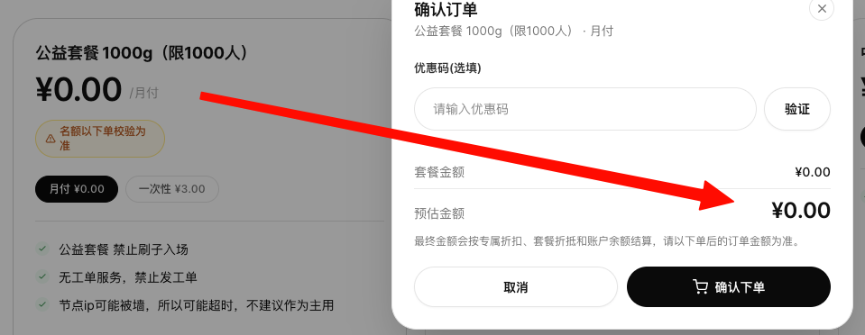
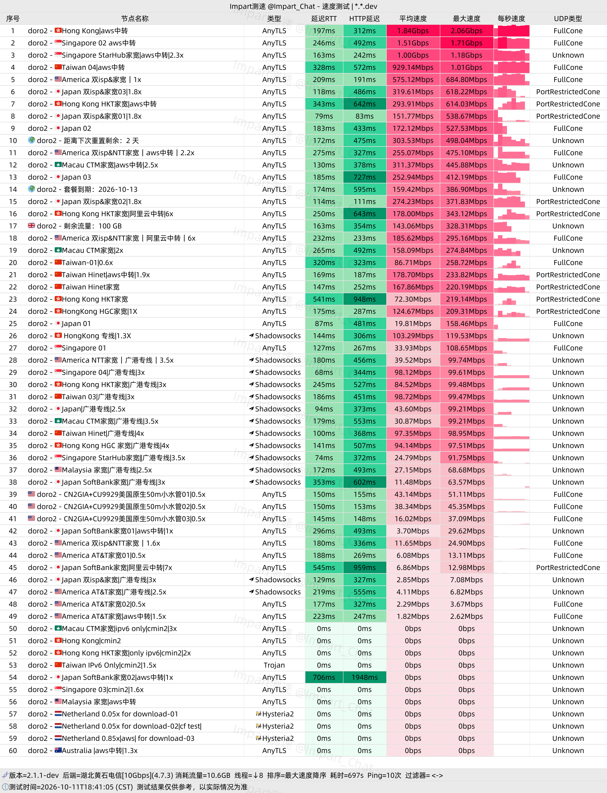
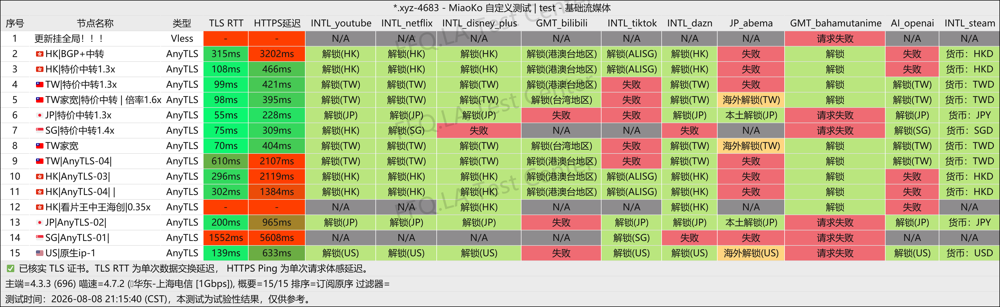
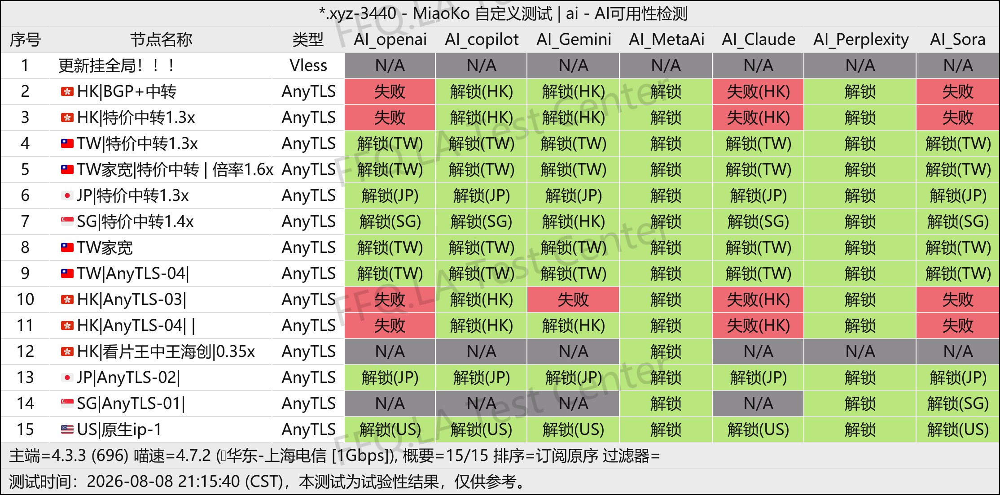
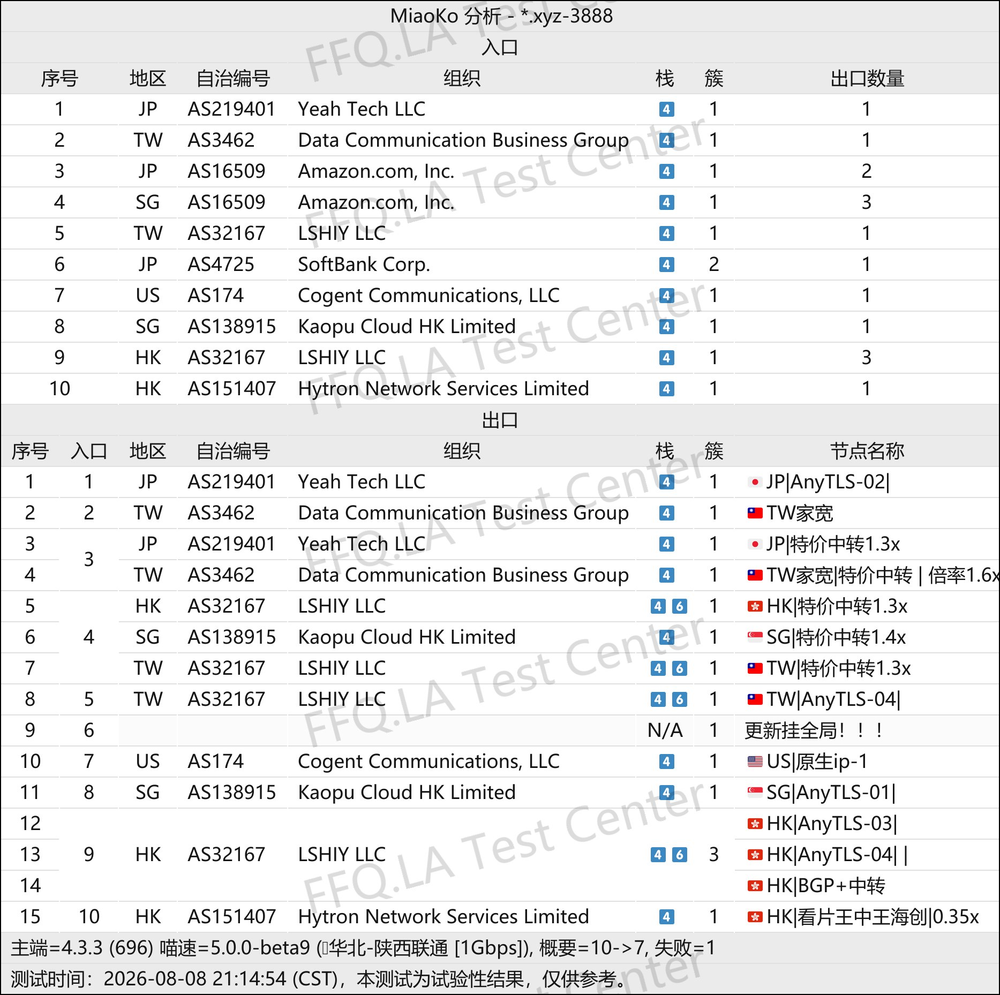

 🇨🇳 [中文](README.md) | 🇺🇸 [English](README_EN.md) | 🇷🇺 [Русский](README_RU.md) | 🇮🇷 فارسی

# آدرس رسمی VPN دوروکلاد (DoroCloud) -(به‌روزرسانی 10 نوامبر 2026)
وب‌سایت رسمی VPN دوروکلاد (DoroCloud)<br>
جدیدترین آدرس: [dorocloud.cn](https://to.iix.im/doro01)<br>
آدرس رسمی: [dorocloud.xyz](https://to.iix.im/doro02)<br>

معرفی بهترین سرویس‌های VPN و اشتراک‌گذاری سرورها در سال ۲۰۲۶: [https://github.com/jdnei/JiChangTuiJian](https://github.com/jdnei/JiChangTuiJian)<br>

## انجمن تلگرامی تخفیف‌ها و مزایای VPN #AD

[گروه قرعه‌کشی VPN](https://331024.de/archives/choujiang) | [گروه گفت‌وگوی VPN](https://331024.de/archives/choujiang) | [گروه آزمایش رایگان VPN](https://331024.de/archives/choujiang)<br>

[https://331024.de/archives/choujiang](https://331024.de/archives/choujiang)

## کد دعوت

`با ثبت‌نام از طریق این کد دعوت، امکان فعال‌سازی طرح رایگان ¥0 فراهم می‌شود (محدود به ۱۰۰۰ کاربر). ارائه‌دهنده می‌تواند این جشنواره را در هر زمانی لغو کند.`

```bash
LLlUeLMa
```

<br>

## کد تخفیف

```bash
ندارد
```

## معرفی

DoroCloud VPN یک سرویس افزایش سرعت و بهبود اتصال اینترنت است که در سال ۲۰۲۶ راه‌اندازی شده است.

این سرویس مسیرهای اتصال مستقیم، انتقال از طریق اینترنت عمومی، مسیریابی واسطه‌ای با استفاده از ارائه‌دهندگان خدمات ابری و برخی سرورهای دارای خطوط اختصاصی را ارائه می‌دهد تا نیازهای کاربران در شرایط مختلف شبکه را پوشش دهد.

سرورها از پروتکل‌هایی مانند AnyTLS پشتیبانی می‌کنند و از منابع شبکه شرکت‌هایی از جمله Tencent Cloud و AWS بهره می‌برند.

DoroCloud برای وب‌گردی روزمره، تماشای محتوای آنلاین و استفاده هم‌زمان از چندین دستگاه مناسب است.

## مزایا

یکی از ویژگی‌های اصلی DoroCloud، تنوع مسیرهای ارتباطی آن است که شامل BGP، IX، مسیرهای واسطه اینترنت عمومی، انتقال داده از طریق AWS و اتصالات مستقیم با ضریب مصرف ترافیک پایین می‌شود.

کاربران می‌توانند بر اساس شرایط شبکه محلی و نیازهای خود، مسیر ارتباطی مناسب را انتخاب کنند.

این سرویس طرح‌های اقتصادی با هزینه اولیه پایین، چندین نقطه ورودی در چین و سرورهایی در کشورهای مختلف ارائه می‌دهد.

DoroCloud به‌ویژه برای کاربرانی جذاب است که می‌خواهند با هزینه کم، مسیرهای ارتباطی مختلف را آزمایش کنند و در عین حال یک VPN برای استفاده روزمره یا اتصال پشتیبان در اختیار داشته باشند.

## طرح‌ها و قیمت‌ها

| نام طرح | حجم ترافیک | دوره پرداخت | قیمت | دستگاه‌های هم‌زمان | دسترسی به سرورها | خدمات / توضیحات |
|---|---:|---|---:|---:|---|---|
| طرح حمایتی 1000G (محدود به ۱۰۰۰ کاربر) | 1000GB | ماهانه / یک‌باره | ماهانه ¥0؛ یک‌باره ¥3 | — | سرورهای طرح حمایتی | ظرفیت هنگام ثبت سفارش بررسی می‌شود؛ سوءاستفاده خودکار و استفاده از ربات ممنوع است؛ پشتیبانی تیکتی ندارد؛ IP سرورها ممکن است مسدود شود یا اتصال با وقفه مواجه شود؛ برای استفاده به‌عنوان VPN اصلی توصیه نمی‌شود |
| طرح کوچک 5G | 5GB | ماهانه | ¥1.20/ماه | ۵ | تمام سرورها به‌جز سرورهای اینترنت خانگی | پشتیبانی از پلتفرم‌های مختلف؛ پشتیبانی فنی شبانه‌روزی |
| طرح متوسط 50G | 50GB | ماهانه | ¥3.30/ماه | ۵ | تمام سرورها به‌جز سرورهای اینترنت خانگی | پشتیبانی از پلتفرم‌های مختلف؛ پشتیبانی فنی شبانه‌روزی |
| طرح بزرگ 100G | 100GB | ماهانه | ¥5.70/ماه | ۵ | تمام سرورها | پشتیبانی از پلتفرم‌های مختلف؛ پشتیبانی فنی شبانه‌روزی |
| طرح بزرگ 200G | 200GB | ماهانه | ¥11.00/ماه | ۸ | تمام سرورها | پشتیبانی از پلتفرم‌های مختلف؛ پشتیبانی فنی شبانه‌روزی |
| طرح بزرگ 300G | 300GB | ماهانه | ¥16.50/ماه | ۵ | تمام سرورها | پشتیبانی از پلتفرم‌های مختلف؛ پشتیبانی فنی شبانه‌روزی |
| بسته بدون انقضای 66G | 66GB | یک‌باره | ¥6.60 | ۵ | تمام سرورها | بدون تاریخ انقضا؛ پشتیبانی از پلتفرم‌های مختلف؛ پشتیبانی فنی شبانه‌روزی |
| بسته بدون انقضای 166G | 166GB | یک‌باره | ¥15.50 | ۵ | تمام سرورها | بدون تاریخ انقضا؛ پشتیبانی از پلتفرم‌های مختلف؛ پشتیبانی فنی شبانه‌روزی |
| بسته بدون انقضای 500G | 500GB | یک‌باره | ¥35.00 | ۹ | تمام سرورها | بدون تاریخ انقضا؛ پشتیبانی از پلتفرم‌های مختلف؛ پشتیبانی فنی شبانه‌روزی |
| طرح با مبلغ سفارشی | قابل تنظیم | ماهانه | ¥3–¥200 | — | — | امکان تعیین مبلغ پرداختی دلخواه با حداکثر یک رقم اعشار؛ پیش از پرداخت باید با مدیر سرویس VPN هماهنگ شود |
| طرح اختصاصی Doro — خریداری نکنید | — | ماهانه | ¥1000/ماه | — | — | طرح اختصاصی خصوصی؛ کاربران عادی نباید آن را خریداری کنند |

## 📊 آزمایش‌های عملی عملکرد و تحلیل نتایج

#### ۱. نتایج آزمایش سرعت China Telecom در ساعات اوج مصرف شبانه

<br>

#### ۲. گزارش رفع محدودیت سرویس‌های پخش آنلاین

<br>

#### ۳. گزارش رفع محدودیت سرویس‌های هوش مصنوعی

<br>

#### ۴. تحلیل سرورهای خروجی و مسیرهای ورودی شبکه

<br>
