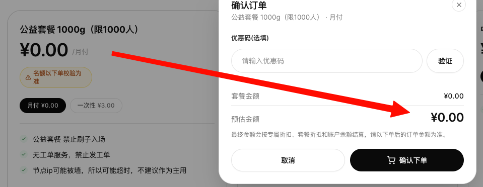
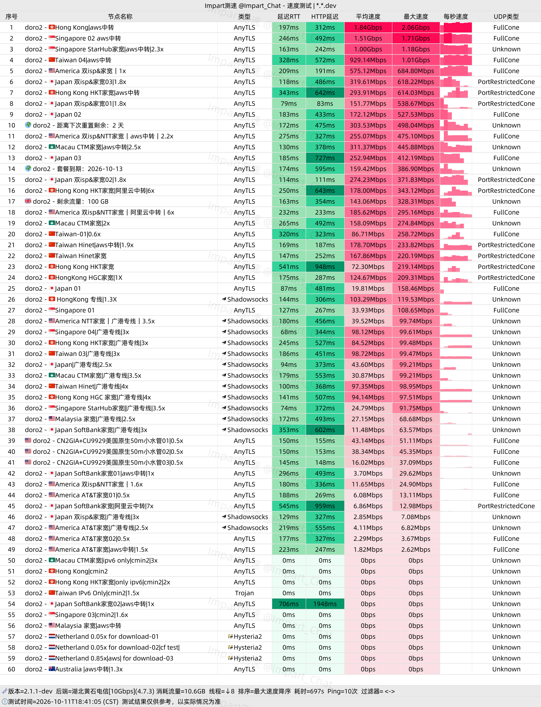
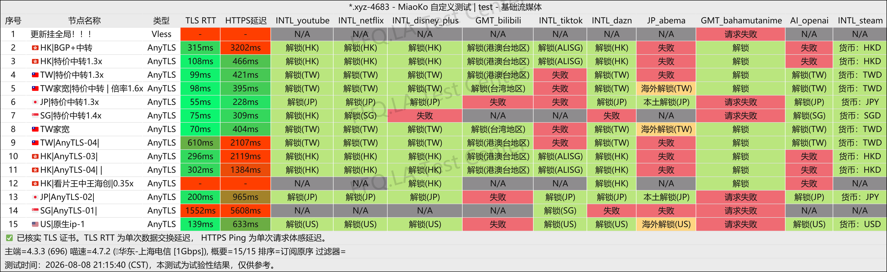
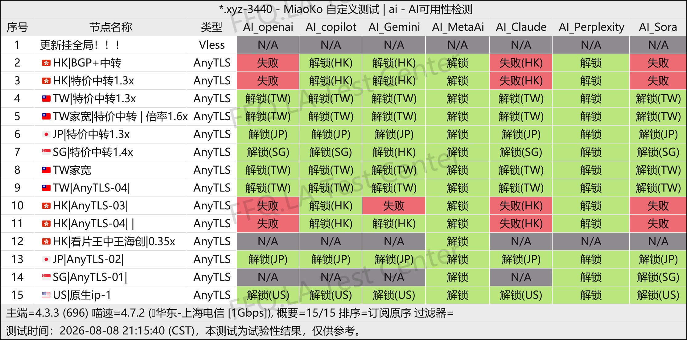
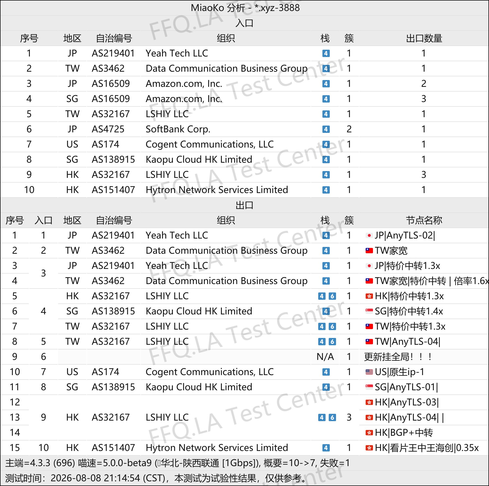

🇨🇳 [中文](README.md) | 🇺🇸 [English](README_EN.md) | 🇷🇺 Русский | 🇮🇷 [فارسی](README_FA.md)

# Официальный сайт DoroCloud VPN (обновлено 11 ноября 2026)

Официальный сайт VPN-сервиса DoroCloud<br>
Новый адрес: [dorocloud.cn](https://to.iix.im/doro01)<br>
Официальный адрес: [dorocloud.xyz](https://to.iix.im/doro02)<br>

Лучшие VPN-сервисы 2026 года: рекомендации и подборка серверов: [https://github.com/jdnei/JiChangTuiJian](https://github.com/jdnei/JiChangTuiJian)<br>

## Telegram-сообщество VPN: акции, скидки и бонусы #AD

[Группа розыгрышей VPN](https://331024.de/archives/choujiang) | [Чат VPN](https://331024.de/archives/choujiang) | [Группа тестирования VPN](https://331024.de/archives/choujiang)<br>

[https://331024.de/archives/choujiang](https://331024.de/archives/choujiang)

## Пригласительный код

`Зарегистрируйтесь с этим пригласительным кодом, чтобы получить доступ к бесплатному тарифу за ¥0 (не более 1000 пользователей). Провайдер может отменить акцию в любое время.`

```bash
LLlUeLMa
```

<br>

## Промокод / Код скидки

```bash
Нет
```

## Описание

DoroCloud VPN — провайдер услуг ускорения интернет-соединения, начавший работу в 2026 году.

Сервис предлагает прямые подключения, промежуточные маршруты через публичный интернет, передачу трафика через инфраструктуру облачных провайдеров и отдельные серверы с выделенными линиями связи.

Такое разнообразие позволяет использовать VPN в различных сетевых условиях и для разных задач.

Серверы поддерживают современные протоколы, включая AnyTLS, и используют сетевые ресурсы таких компаний, как Tencent Cloud и AWS.

DoroCloud подходит для повседневного просмотра веб-страниц, потокового видео, развлечений и одновременного использования нескольких устройств.

## Преимущества

Главной особенностью DoroCloud является разнообразие доступных сетевых маршрутов, включая BGP, IX, промежуточные соединения через публичный интернет, маршруты с передачей данных через AWS и прямые подключения с низким коэффициентом расхода трафика.

Пользователи могут гибко выбирать маршруты с учётом качества своего интернет-соединения и индивидуальных потребностей.

Сервис предлагает недорогие начальные тарифы, несколько точек входа в Китае и зарубежные серверы.

DoroCloud особенно привлекателен для пользователей, которые хотят тестировать различные сетевые подключения с минимальными затратами и использовать VPN как для повседневных задач, так и в качестве резервного соединения.

## Тарифы и цены

| Название тарифа | Объём трафика | Период оплаты | Цена | Одновременные подключения | Доступ к серверам | Услуги / Примечания |
|---|---:|---|---:|---:|---|---|
| Общественный льготный тариф 1000G (до 1000 пользователей) | 1000GB | Ежемесячно / Разовая покупка | ¥0 в месяц; ¥3 разово | — | Серверы льготного тарифа | Доступность проверяется при оформлении заказа; автоматизированное злоупотребление и использование ботов запрещены; техническая поддержка через тикеты отсутствует; IP-адреса серверов могут блокироваться или соединение может завершаться по тайм-ауту; не рекомендуется в качестве основного VPN |
| Малый тариф 5G | 5GB | Ежемесячно | ¥1.20/месяц | 5 | Все серверы, кроме серверов с домашними IP | Поддержка различных платформ; круглосуточная техническая поддержка 24/7 |
| Средний тариф 50G | 50GB | Ежемесячно | ¥3.30/месяц | 5 | Все серверы, кроме серверов с домашними IP | Поддержка различных платформ; круглосуточная техническая поддержка 24/7 |
| Большой тариф 100G | 100GB | Ежемесячно | ¥5.70/месяц | 5 | Все серверы | Поддержка различных платформ; круглосуточная техническая поддержка 24/7 |
| Большой тариф 200G | 200GB | Ежемесячно | ¥11.00/месяц | 8 | Все серверы | Поддержка различных платформ; круглосуточная техническая поддержка 24/7 |
| Большой тариф 300G | 300GB | Ежемесячно | ¥16.50/месяц | 5 | Все серверы | Поддержка различных платформ; круглосуточная техническая поддержка 24/7 |
| Бессрочный пакет 66G | 66GB | Разовая покупка | ¥6.60 | 5 | Все серверы | Без срока действия; поддержка различных платформ; круглосуточная техническая поддержка 24/7 |
| Бессрочный пакет 166G | 166GB | Разовая покупка | ¥15.50 | 5 | Все серверы | Без срока действия; поддержка различных платформ; круглосуточная техническая поддержка 24/7 |
| Бессрочный пакет 500G | 500GB | Разовая покупка | ¥35.00 | 9 | Все серверы | Без срока действия; поддержка различных платформ; круглосуточная техническая поддержка 24/7 |
| Тариф с индивидуальной суммой оплаты | Настраиваемый | Ежемесячно | ¥3–¥200 | — | — | Пользователь самостоятельно указывает сумму оплаты с точностью не более одного знака после запятой; перед оплатой необходимо согласовать условия с владельцем VPN-сервиса |
| Эксклюзивный тариф Doro — не покупать | — | Ежемесячно | ¥1000/месяц | — | — | Частный эксклюзивный тариф; не предназначен для обычных пользователей |

## 📊 Практические тесты производительности и анализ

#### 1. Результаты тестирования скорости China Telecom в вечерние часы пик

<br>

#### 2. Отчёт о разблокировке стриминговых сервисов

<br>

#### 3. Отчёт о доступности ИИ-сервисов

<br>

#### 4. Анализ выходных серверов и входящих сетевых маршрутов

<br>
